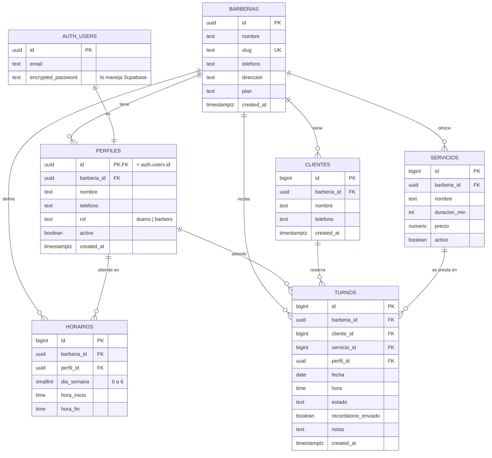

# Flow Cavernícola — SaaS Parte 5: Diseño de la base de datos

**Alumno:** Tobias Juárez · **Curso:** 7° 3ª · **Materia:** PDISC 7.6
**Tecnología:** Vue 3 + Supabase (PostgreSQL + Supabase Auth)

---

## 1. Qué información necesita guardar la función principal

La función principal de Flow Cavernícola es que un cliente reserve un turno en una barbería sin tener que registrarse, y que el barbero vea su agenda ordenada. Para eso necesito guardar:

- **Las barberías** que usan la plataforma (cada una es un cliente del SaaS).
- **Los barberos** que trabajan en cada barbería y que inician sesión.
- **Los servicios** que ofrece cada barbería, con duración y precio.
- **Los horarios** en los que atiende cada barbero.
- **Los clientes** que reservan (solo nombre y WhatsApp, sin cuenta).
- **Los turnos**, que unen todo lo anterior: quién, con qué barbero, qué servicio, qué día y a qué hora.

## 2. Entidades principales (futuras tablas)

| Entidad | Qué representa | Qué datos guarda |
|---|---|---|
| **barberias** | Cada negocio que usa la plataforma. Es la "organización" del SaaS. | Nombre, slug para el link de reserva, teléfono, dirección y plan contratado. |
| **perfiles** | Los barberos que inician sesión. Cada perfil está atado a un usuario de Supabase Auth. | Barbería a la que pertenece, nombre, teléfono, rol (dueño o barbero) y si está activo. |
| **servicios** | Lo que ofrece cada barbería (corte, barba, diseño…). | Nombre, duración en minutos, precio y si está activo. |
| **horarios** | Las franjas en las que atiende cada barbero. | Barbero, día de la semana, hora de inicio y hora de fin. |
| **clientes** | Las personas que reservan turnos. No tienen cuenta. | Nombre y teléfono (WhatsApp, para el recordatorio). |
| **turnos** | La reserva en sí. Es la tabla central. | Cliente, servicio, barbero, fecha, hora, estado y si ya se mandó el recordatorio. |

## 3. Diagrama entidad-relación

> PK = clave primaria · FK = clave foránea · UK = única
> En GitHub el diagrama se dibuja solo a partir del código de abajo.



**Cardinalidades:**

- Una barbería tiene **muchos** perfiles, servicios, clientes, horarios y turnos (1:N). Cada uno de esos registros pertenece a **una sola** barbería.
- Un perfil (barbero) tiene **muchos** horarios y atiende **muchos** turnos (1:N).
- Un cliente puede tener **muchos** turnos (1:N).
- Un servicio puede aparecer en **muchos** turnos (1:N).
- Cada turno tiene **exactamente un** cliente, un servicio y un barbero.
- Cada perfil corresponde a **exactamente un** usuario de Supabase Auth (1:1).

## 4. Cómo represento a cada barbería (multi-cliente)

Todas las barberías comparten la misma base de datos, pero cada una tiene su "etiqueta": la columna **`barberia_id`**, que está en todas las tablas (perfiles, servicios, horarios, clientes y turnos). Es como un edificio de departamentos: el edificio es uno solo, pero cada cosa tiene anotado a qué depto pertenece.

Para que los datos de una barbería nunca se mezclen con los de otra, uso tres cosas:

1. **Claves foráneas compuestas en `turnos` y `horarios`.** En vez de apuntar solo a `cliente_id`, el turno apunta a `(cliente_id, barberia_id)`. Lo mismo con el servicio y el barbero. Así la base **rechaza** un turno de La Cueva que use un servicio de El Tano. Lo probé y da error.
2. **Restricciones únicas por barbería.** Por ejemplo `unique (barberia_id, telefono)` en clientes: el mismo número puede ser cliente de dos barberías distintas (son dos registros separados), pero dentro de una misma barbería no se repite.
3. **Row Level Security (RLS) de Supabase.** Cada tabla tiene políticas que dicen "solo podés ver y tocar las filas cuyo `barberia_id` sea el de tu barbería". La función `mi_barberia()` busca la barbería del usuario logueado (`auth.uid()`). Aunque alguien modifique el código del frontend, la base no le devuelve datos de otra barbería.

## 5. Usuarios y roles

**Las contraseñas no se guardan en mis tablas.** El registro y el login los maneja **Supabase Auth**, que guarda el email y la contraseña encriptada en su propia tabla interna (`auth.users`). Mi tabla `perfiles` usa como clave primaria el **mismo `id`** del usuario de Auth, y guarda solo los datos del negocio: nombre, teléfono, rol y barbería.

| Rol | Quién es | Qué puede hacer |
|---|---|---|
| **dueno** | Quien registró la barbería. Hay uno solo por barbería. | Todo lo del barbero, y además editar los datos de la barbería. |
| **barbero** | Empleado de la barbería. | Ver y gestionar los turnos, clientes, servicios y horarios de su barbería, y editar su propio perfil. |
| **cliente** (sin cuenta) | Quien reserva desde el link público. | Ver la barbería, sus servicios y horarios. No ve los turnos ni los datos de otros clientes. |

**Registro automático:** cuando alguien se registra desde `registro.vue`, la app manda el nombre de la barbería en `user_metadata.barberia`. Un **trigger** (`al_registrarse_usuario`) crea solo la barbería, le genera el slug (por ejemplo "Barbería El Tano" → `barberia-el-tano`) y crea el perfil con rol `dueno`.

## 6. Organización de archivos y carpetas

```
flow-cavernicola-main/
├── docs/
│   └── SaaS-Parte5.md        ← este documento (incluye el diagrama ER)
├── supabase/
│   ├── schema.sql            ← crea tablas, relaciones, restricciones, RLS y trigger
│   └── seed.sql              ← datos ficticios de 2 barberías
├── src/
│   ├── views/                ← pantallas completas (una por ruta)
│   ├── components/           ← piezas reutilizables (TurnoForm, TurnoDetalle)
│   ├── router/               ← rutas y protección de páginas con login
│   ├── services/
│   │   └── db.js             ← TODAS las operaciones con la base de datos
│   ├── composables/          ← lógica reutilizable de Vue (useHideOnScroll)
│   ├── data/                 ← datos de ejemplo (mock) de la etapa anterior
│   ├── supabase.js           ← conexión a Supabase (y modo demo sin conexión)
│   ├── App.vue               ← componente raíz (barra de navegación + router-view)
│   ├── main.js               ← arranca la app
│   └── style.css             ← estilos globales
├── index.html
├── package.json
└── vite.config.js
```

| Carpeta / archivo | Función |
|---|---|
| `views/` | Las pantallas: agenda del barbero, login, registro, cambiar contraseña, reserva del cliente y confirmación. |
| `components/` | Partes que se reutilizan dentro de las vistas, como el formulario de turno. |
| `router/` | Define las rutas y el `beforeEach` que manda al login si la página necesita sesión. |
| `services/db.js` | El lugar central de la base de datos. Las vistas llaman a funciones como `listarTurnosDelDia()` o `crearTurno()` en vez de escribir consultas sueltas. Si cambia una tabla, se toca solo este archivo. |
| `supabase.js` | Crea el cliente de Supabase con las variables del `.env`. |
| `supabase/` | Los scripts SQL para reconstruir la base desde cero. |
| `docs/` | La documentación del proyecto. |
| `data/` | Datos mock que usé antes de tener base. Se va a eliminar cuando todas las vistas usen `services/db.js`. |

## 7. Creación de la base en Supabase

La estructura está en **`supabase/schema.sql`**. Para reconstruirla:

1. Entrar al proyecto en Supabase → **SQL Editor** → **New query**.
2. Pegar `schema.sql` y ejecutar con **Run**.
3. Hacer lo mismo con `seed.sql` para cargar los datos de prueba.

El script se puede correr varias veces: al principio borra las tablas y las vuelve a crear.

**Restricciones que incluí:**

- `check` en los valores permitidos: `plan`, `rol`, `estado`, `dia_semana` (0 a 6), `precio >= 0`, `duracion_min > 0` y `hora_fin > hora_inicio`.
- `unique` en el slug, en el servicio por barbería y en el teléfono del cliente por barbería.
- Un solo dueño por barbería (índice único parcial).
- **`turnos_sin_pisar`:** un barbero no puede tener dos turnos el mismo día a la misma hora. Los cancelados no cuentan, así ese horario se libera.
- `on delete cascade`: si se borra una barbería, se borra todo lo suyo. Un servicio que tiene turnos **no** se puede borrar (hay que desactivarlo con `activo = false`).

## 8. Datos de prueba

`supabase/seed.sql` carga dos barberías:

| | La Cueva Barber | Barbería El Tano |
|---|---|---|
| Barberos | Gastón "Tano" Ríos (dueño), Rodrigo "Rulo" Paz (barbero) | Nicolás Ferreyra (dueño) |
| Servicios | 4 | 3 |
| Clientes | 3 | 2 |
| Turnos | 5 | 3 |

Usuarios para probar el login (contraseña `123456`): `tano@lacueva.com`, `rulo@lacueva.com`, `nico@eltano.com`.

**Lo que comprobé con estos datos:**

- **Facundo Medina** tiene el mismo teléfono en las dos barberías y aparecen como **dos clientes distintos**, cada uno en su barbería.
- Logueado como Tano (La Cueva) veo **5 turnos y 3 clientes**: solo los de mi barbería.
- Logueado como Nico (El Tano), si intento cargar un cliente en La Cueva, la base lo **rechaza** por RLS.
- Un turno de La Cueva con un servicio de El Tano **falla** por la clave foránea compuesta.
- Cargar dos turnos al mismo barbero, mismo día y hora, **falla** por `turnos_sin_pisar`.
- Alguien sin sesión puede ver las barberías y sus servicios (para reservar), pero **ve 0 turnos y 0 clientes**.

Al final de `seed.sql` dejé comentadas las consultas para repetir estas pruebas.

## 9. Diccionario de datos

### barberias
| Campo | Tipo | Descripción |
|---|---|---|
| id | uuid (PK) | Identificador de la barbería. Se genera solo. |
| nombre | text | Nombre comercial. Obligatorio. |
| slug | text (UK) | Parte del link público de reserva (ej: `la-cueva-barber`). Solo minúsculas, números y guiones. |
| telefono | text | Teléfono de contacto del local. |
| direccion | text | Dirección del local. |
| plan | text | Plan contratado: `gratis`, `basico`, `profesional` o `empresa`. Por defecto `gratis`. |
| created_at | timestamptz | Fecha y hora de alta. |

### perfiles
| Campo | Tipo | Descripción |
|---|---|---|
| id | uuid (PK, FK → auth.users) | Mismo id que el usuario de Supabase Auth. |
| barberia_id | uuid (FK → barberias) | Barbería en la que trabaja. |
| nombre | text | Nombre del barbero. |
| telefono | text | Teléfono del barbero. |
| rol | text | `dueno` o `barbero`. |
| activo | boolean | Si sigue trabajando en la barbería. |
| created_at | timestamptz | Fecha y hora de alta. |

### servicios
| Campo | Tipo | Descripción |
|---|---|---|
| id | bigint (PK) | Identificador autoincremental. |
| barberia_id | uuid (FK → barberias) | Barbería que ofrece el servicio. |
| nombre | text | Nombre del servicio (ej: "Corte + barba"). No se repite dentro de una barbería. |
| duracion_min | integer | Duración en minutos. Mayor a 0. |
| precio | numeric(10,2) | Precio en pesos. No puede ser negativo. |
| activo | boolean | Si se muestra para reservar. |

### horarios
| Campo | Tipo | Descripción |
|---|---|---|
| id | bigint (PK) | Identificador autoincremental. |
| barberia_id | uuid (FK → barberias) | Barbería a la que pertenece. |
| perfil_id | uuid (FK → perfiles) | Barbero que atiende en esa franja. |
| dia_semana | smallint | Día: 0 = domingo, 1 = lunes … 6 = sábado. |
| hora_inicio | time | Hora en que empieza a atender. |
| hora_fin | time | Hora en que termina. Tiene que ser mayor que la de inicio. |

### clientes
| Campo | Tipo | Descripción |
|---|---|---|
| id | bigint (PK) | Identificador autoincremental. |
| barberia_id | uuid (FK → barberias) | Barbería en la que reservó. |
| nombre | text | Nombre del cliente. |
| telefono | text | WhatsApp para el recordatorio. Único dentro de cada barbería. |
| created_at | timestamptz | Fecha y hora en que reservó por primera vez. |

### turnos
| Campo | Tipo | Descripción |
|---|---|---|
| id | bigint (PK) | Identificador autoincremental. |
| barberia_id | uuid (FK → barberias) | Barbería del turno. |
| cliente_id | bigint (FK → clientes) | Cliente que reservó. Tiene que ser de la misma barbería. |
| servicio_id | bigint (FK → servicios) | Servicio reservado. Tiene que ser de la misma barbería. |
| perfil_id | uuid (FK → perfiles) | Barbero que atiende. Tiene que ser de la misma barbería. |
| fecha | date | Día del turno. |
| hora | time | Hora del turno. |
| estado | text | `pendiente`, `confirmado`, `completado` o `cancelado`. |
| recordatorio_enviado | boolean | Si ya se mandó el recordatorio por WhatsApp. |
| notas | text | Comentario opcional (ej: "quiere degradé bajo"). |
| created_at | timestamptz | Cuándo se hizo la reserva. |
