# Flow Cavernícola — SaaS Parte 6: Función principal

**Alumno:** Tobias Juárez · **Curso:** 7° 3ª · **Materia:** PDISC 7.6
**Tecnología:** Vue 3 + Vue Router + Supabase (PostgreSQL, Auth y Row Level Security)

---

## 1. Repaso del proyecto

| | |
|---|---|
| **Problema** | Las barberías chicas toman los turnos por WhatsApp. El barbero contesta mensajes mientras corta, se le pisan turnos y no tiene la agenda ordenada en un solo lugar. |
| **Cliente ideal** | El dueño de una barbería chica de barrio, con 1 a 3 barberos, que hoy maneja todo desde el celular. |
| **MVP** | Agenda de turnos online. Cada barbería tiene su propio link, el cliente reserva sin registrarse y el barbero ve todo ordenado. El recordatorio por WhatsApp queda para la próxima etapa. |
| **Modelo de datos** | 6 tablas: `barberias`, `perfiles`, `servicios`, `horarios`, `clientes` y `turnos`. Todas tienen `barberia_id`, así cada dato queda atado a su barbería. El detalle está en [SaaS-Parte5.md](SaaS-Parte5.md). |

**Historias de usuario que implementé en esta etapa**

| # | Historia |
|---|---|
| HU1 | Como **cliente**, quiero reservar un turno desde el link de la barbería sin crearme una cuenta, para no tener que mandar mensajes. |
| HU2 | Como **cliente**, quiero ver solo los horarios libres, para no elegir uno que ya está ocupado. |
| HU3 | Como **barbero**, quiero ver los turnos del día ordenados por hora, para organizarme. |
| HU4 | Como **barbero**, quiero cargar, editar, cancelar y eliminar turnos a mano, para los clientes que me escriben o vienen al local. |
| HU5 | Como **barbero**, quiero que nadie de otra barbería pueda ver mis turnos ni mis clientes. |

## 2. Función principal elegida: reservar un turno

Elegí **reservar un turno** porque es el corazón del MVP: si el cliente no puede reservar solo, Flow Cavernícola no le resuelve nada al barbero. Además es la función que usa todo lo que diseñé en la Parte 5: el link con el slug de la barbería, los servicios, los horarios, los clientes, los turnos y la agenda donde el barbero consulta lo que se guardó.

## 3. Recorrido paso a paso

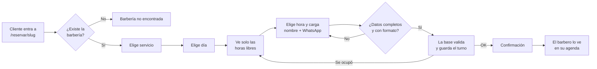

### Del lado del cliente (sin cuenta)

1. **Entra al link de la barbería**, por ejemplo `/reservar/la-cueva-barber`. La app busca la barbería por su slug con `buscarBarberiaPorSlug()`. Si el link está mal, muestra "Barbería no encontrada".
2. **Ve los servicios** con duración y precio (`listarServicios()`) y elige uno.
3. **Elige el día** entre los próximos 14.
4. **La app le pide a la base las horas libres** de ese día (`horariosDisponibles()`). Solo aparecen horas en las que trabaja al menos un barbero, que no tienen turno y que todavía no pasaron.
5. **Elige la hora y completa su nombre y su WhatsApp.**
6. **Toca "Confirmar turno".** Primero valido en Vue que esté todo completo y bien escrito. Si algo falla, muestro el error y no mando nada a la base.
7. **Si está todo bien, llamo a `reservarTurno()`.** La base vuelve a validar, le asigna un barbero libre, crea el cliente (o reutiliza el que ya tenía ese teléfono) y guarda el turno.
8. **Ve la confirmación** con la barbería, el día, la hora y el servicio.

| 1. Entra al link | 2 a 5. Elige y completa | 8. Confirmación |
|:---:|:---:|:---:|
| 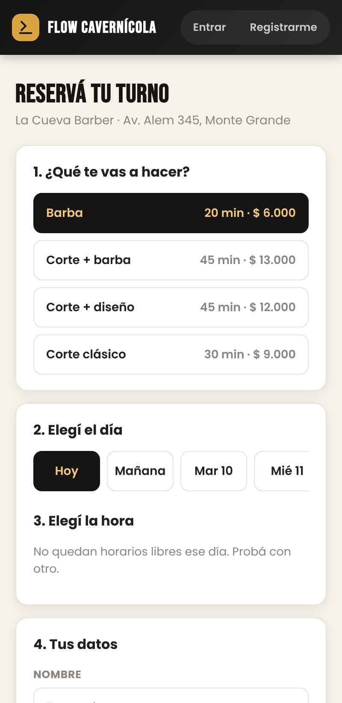 | 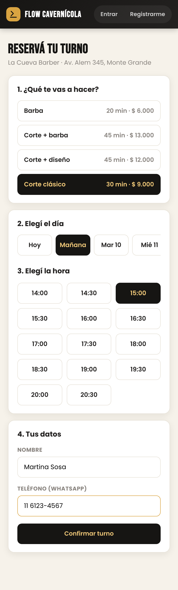 | 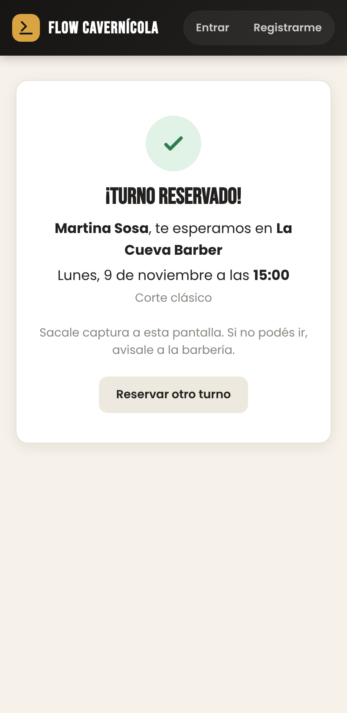 |

### Del lado del barbero (con cuenta)

1. **Inicia sesión** en `/login`. Si intenta entrar a `/agenda` sin sesión, el router lo manda al login.
2. **Ve su agenda del día** (`listarTurnosDelDia()`), con cliente, servicio, barbero y estado. Puede cambiar de día con el calendario.
3. **Toca un turno para editarlo**: cambia el estado (pendiente, confirmado, completado o cancelado), agrega notas o lo elimina. Con "+ Nuevo turno" carga uno a mano.
4. **La app le avisa** si se guardó ("✓ Turno actualizado.") o si hubo un error.

| 2. Agenda con la reserva | 3 y 4. Turno editado |
|:---:|:---:|
| 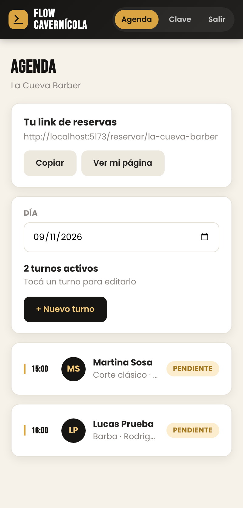 | 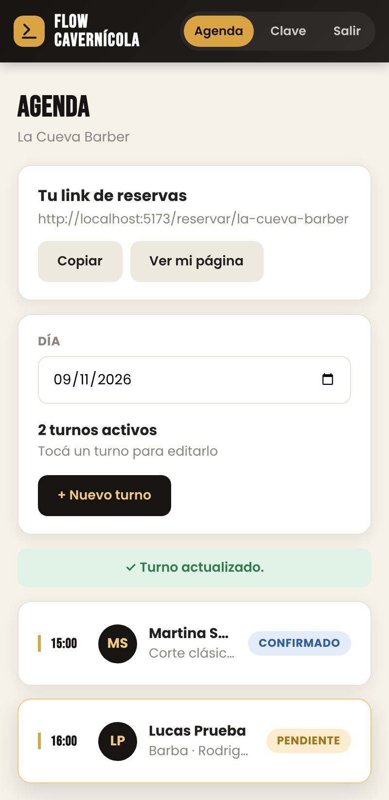 |

## 4. Navegación con Vue Router

| Ruta | Vista | Quién puede entrar |
|---|---|---|
| `/reservar/:slug` | `ReservaCliente.vue` | Cualquiera (es la página que comparte el barbero) |
| `/confirmacion` | `ConfirmacionReserva.vue` | Cualquiera |
| `/login` | `LoginView.vue` | Solo si **no** inició sesión |
| `/registro` | `RegistroView.vue` | Solo si **no** inició sesión |
| `/agenda` | `AgendaBarbero.vue` + `TurnoForm.vue` (ventana para crear o editar) | Solo barberos con sesión |
| `/cambiar-password` | `CambiarPasswordView.vue` | Solo barberos con sesión |
| `/` y cualquier otra | redirige a `/agenda` | — |

Las rutas privadas tienen `meta: { requiereAuth: true }` y las de invitados `meta: { soloInvitados: true }`. Un `router.beforeEach` revisa la sesión antes de cada cambio de página y redirige si corresponde. Si el barbero quería ir a una página protegida, después del login lo devuelvo ahí (`?redirect=`).

## 5. Operaciones para guardar y consultar

Todas las operaciones con la base están en **`src/services/db.js`**. Las vistas nunca escriben consultas sueltas: llaman a estas funciones.

| Función | Tipo | Qué hace | Contra qué |
|---|---|---|---|
| `buscarBarberiaPorSlug(slug)` | Consulta | Busca la barbería del link | tabla `barberias` |
| `listarServicios(barberiaId)` | Consulta | Servicios con precio y duración | tabla `servicios` |
| `horariosDisponibles(slug, fecha)` | Consulta | Horas libres de ese día | función `horarios_disponibles` |
| `reservarTurno({...})` | **Guarda** | Crea la reserva del cliente | función `reservar_turno` |
| `obtenerMiPerfil()` | Consulta | Datos del barbero y de su barbería | `perfiles` + `barberias` |
| `listarTurnosDelDia(barberiaId, fecha)` | Consulta | Agenda con cliente, servicio y barbero unidos | `turnos` + `clientes` + `servicios` + `perfiles` |
| `guardarCliente(...)` | **Guarda** | Crea el cliente o le actualiza el nombre (upsert por teléfono) | tabla `clientes` |
| `crearTurno` / `actualizarTurno` / `eliminarTurno` | **Guarda** | Alta, modificación y baja desde la agenda | tabla `turnos` |

**¿Por qué el cliente reserva con funciones de la base y no con un `insert` común?** Las políticas de seguridad (RLS) de `clientes` y `turnos` solo dejan entrar a barberos logueados, y el cliente no tiene cuenta. Abrir esas tablas a cualquiera hubiera dejado ver los datos de todos. Por eso creé dos funciones en PostgreSQL con `security definer` (sección 9 de `supabase/schema.sql`). Corren con permisos del dueño de la base, pero hacen **una sola cosa controlada**:

- `horarios_disponibles` devuelve solo horas libres, sin nombres ni teléfonos de otros clientes.
- `reservar_turno` valida todo y recién ahí guarda.

Desde Vue se llaman así:

```js
supabase.rpc("reservar_turno", {
  p_slug: slug, p_servicio_id: servicioId, p_fecha: fecha,
  p_hora: hora, p_nombre: nombre, p_telefono: telefono,
});
```

## 6. Validaciones y mensajes

Valido en **dos niveles**. En Vue, antes de mandar nada, para que el usuario vea el error enseguida. En la base de datos, para que nadie pueda saltear las reglas aunque modifique la página.

### En la página (`src/utils/validaciones.js`)

| Campo | Regla | Mensaje que ve el usuario |
|---|---|---|
| Hora | Obligatoria | "Elegí un horario disponible." |
| Nombre | Obligatorio, mínimo 2 letras, solo letras | "Completá el nombre." / "El nombre es muy corto." / "El nombre solo puede tener letras." |
| Teléfono | Obligatorio, solo números, espacios, guiones o +, entre 8 y 15 números | "El teléfono solo puede tener números, espacios, guiones o +." / "El teléfono tiene que tener entre 8 y 15 números." |
| Email (login y registro) | Formato `algo@algo.algo` | "El email no tiene un formato válido." |
| Contraseña (registro) | Mínimo 6 caracteres, las dos iguales | "La contraseña tiene que tener al menos 6 caracteres." / "Las contraseñas no coinciden." |
| Turno cargado por el barbero | Fecha, hora, cliente, teléfono y servicio | "Completá fecha, hora, cliente, teléfono y servicio." |

### En la base de datos

| Regla | Dónde | Mensaje |
|---|---|---|
| La barbería del link existe | `reservar_turno` | "Esa barbería no existe." |
| El servicio es de esa barbería y está activo | `reservar_turno` | "Ese servicio no está disponible." |
| El horario no pasó | `reservar_turno` | "Ese horario ya pasó." |
| Hay un barbero libre a esa hora | `reservar_turno` | "Ese horario se acaba de ocupar. Elegí otro." |
| Un barbero no puede tener dos turnos a la misma hora | índice único `turnos_sin_pisar` | "Ese barbero ya tiene un turno ese día a esa hora." |
| Cliente, servicio y barbero son de la misma barbería que el turno | claves foráneas compuestas | (la base rechaza el turno) |

### Cuando sale bien

- El cliente ve la pantalla **"¡Turno reservado!"** con todos los datos.
- El barbero ve un aviso verde: **"✓ Turno creado."**, **"✓ Turno actualizado."** o **"✓ Turno eliminado."**

| Teléfono mal escrito | Dos clientes, mismo horario | Turno repetido (barbero) |
|:---:|:---:|:---:|
| 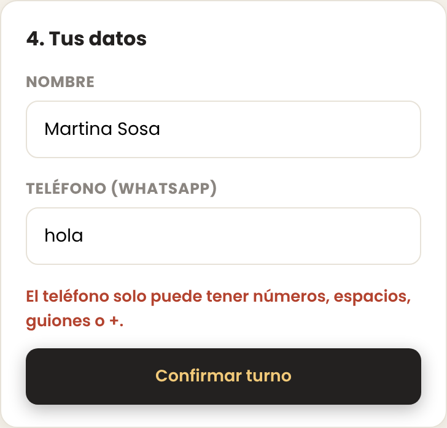 | 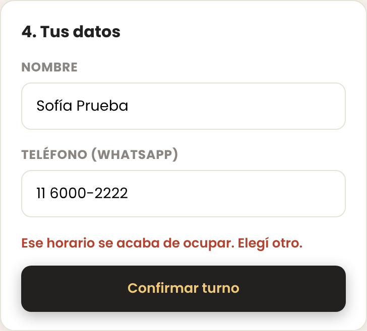 | 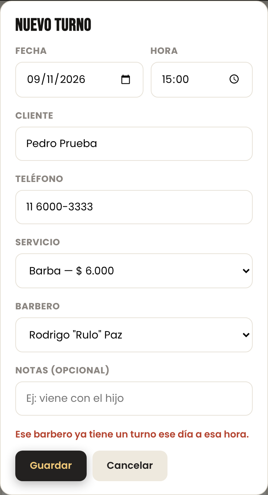 |

## 7. Los datos quedan vinculados a cada barbería

- **Cuando reserva un cliente**, la barbería sale del slug del link. `reservar_turno` busca la barbería por ese slug y guarda su `barberia_id` en el cliente y en el turno. La página nunca manda el id de la barbería, así que no se puede "colar" un turno en otra.
- **Cuando trabaja el barbero**, `obtenerMiPerfil()` trae su barbería, y cada consulta filtra por ese `barberia_id`. Aunque alguien cambie el código del navegador, las políticas RLS usan `mi_barberia()`, que sale del usuario logueado (`auth.uid()`). La base no le devuelve filas de otra barbería.
- **Cuando se registra una barbería nueva**, un trigger le crea la barbería, el perfil de dueño, el slug del link y unos servicios y horarios de arranque, para que pueda recibir reservas desde el primer minuto.
- **Las claves foráneas compuestas** impiden que un turno de La Cueva use un servicio o un cliente de El Tano.

Lo comprobé en las pruebas A1 y A2: el dueño de otra barbería no ve las reservas de La Cueva, y sin sesión la API no devuelve ningún turno.

| A1. Nico (Barbería El Tano) el mismo lunes |
|:---:|
| 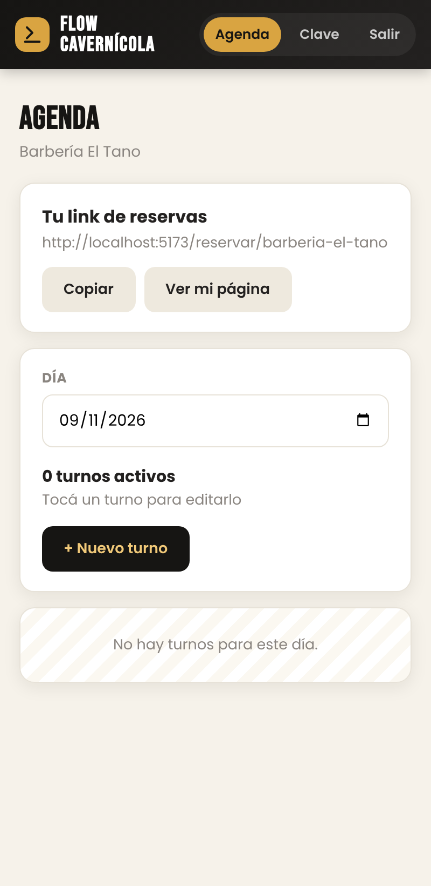 |

## 8. Pruebas con datos ficticios

Hice las pruebas el 8/11/2026 contra la base real de Supabase, con los usuarios del `seed.sql` (`tano@lacueva.com`, `nico@eltano.com`) y clientes inventados. Reservé para el **lunes 9/11**: ese día en La Cueva solo trabaja Rulo, de 14 a 21 hs.

### Camino completo (ingresar, cargar, guardar y consultar)

| # | Qué hice | Qué esperaba | Qué pasó | |
|---|---|---|---|---|
| P1 | Abrí `/reservar/la-cueva-barber` | Ver la barbería y sus servicios | Muestra "La Cueva Barber · Av. Alem 345" y 4 servicios con precio | ✅ |
| P2 | Elegí "Hoy" (domingo) | Que no haya horarios | "No quedan horarios libres ese día. Probá con otro." | ✅ |
| P3 | Elegí el lunes | Solo las horas de Rulo | 14 horarios, de 14:00 a 20:30 | ✅ |
| P4 | Reservé Corte clásico a las 15:00 como Martina Sosa, 11 6123-4567 | Pantalla de confirmación | "¡Turno reservado! Martina Sosa, te esperamos en La Cueva Barber. Lunes, 9 de noviembre a las 15:00" | ✅ |
| P5 | Volví a la página y elegí el lunes | Que las 15:00 ya no aparezcan | No aparecen | ✅ |
| P6 | Entré como Tano y fui al lunes 9 | Ver la reserva en la agenda | "15:00 · Martina Sosa · Corte clásico · Rodrigo Rulo Paz · PENDIENTE" | ✅ |
| P7 | Le cambié el estado a "confirmado" | Mensaje de éxito | "✓ Turno actualizado." y el turno pasa a CONFIRMADO | ✅ |

### Datos que faltan o están mal

| # | Qué hice | Qué pasó | |
|---|---|---|---|
| E1 | Toqué "Confirmar turno" sin elegir hora | "Elegí un horario disponible." | ✅ |
| E2 | Confirmé sin nombre | "Completá el nombre." | ✅ |
| E3 | Puse "hola" en el teléfono | "El teléfono solo puede tener números, espacios, guiones o +." | ✅ |
| E4 | Puse "1234" en el teléfono | "El teléfono tiene que tener entre 8 y 15 números." | ✅ |
| E5 | Puse "M4rtina" en el nombre | "El nombre solo puede tener letras." | ✅ |
| E6 | Entré con el email "tano" | "El email no tiene un formato válido." | ✅ |
| E7 | Entré con la contraseña equivocada | "Email o contraseña incorrectos." | ✅ |
| E8 | Como barbero, guardé un turno sin cliente | "Completá fecha, hora, cliente, teléfono y servicio." | ✅ |

### Errores de la operación

| # | Qué hice | Qué pasó | |
|---|---|---|---|
| E9 | Abrí la página en dos navegadores, elegí las 16:00 en los dos y confirmé primero con Lucas Prueba y después con Sofía Prueba | Lucas reservó. Sofía recibió "Ese horario se acaba de ocupar. Elegí otro." y la lista de horas se actualizó | ✅ |
| E10 | Como barbero, cargué a Pedro Prueba con Rulo a las 15:00 (ya tenía a Martina) | "Ese barbero ya tiene un turno ese día a esa hora." | ✅ |
| E11 | Abrí `/reservar/barberia-que-no-existe` | "Barbería no encontrada. Revisá que el link esté bien escrito…" | ✅ |

### Cada barbería ve solo lo suyo

| # | Qué hice | Qué pasó | |
|---|---|---|---|
| A1 | Entré como Nico (Barbería El Tano) y fui al lunes 9 | "0 turnos activos": no ve a Martina ni a Lucas, que son de La Cueva | ✅ |
| A2 | Pedí la tabla `turnos` a la API sin iniciar sesión, solo con la clave pública | Devuelve 0 turnos: RLS no deja leerlos | ✅ |

| E7. Login con contraseña equivocada | E11. Link que no existe |
|:---:|:---:|
| 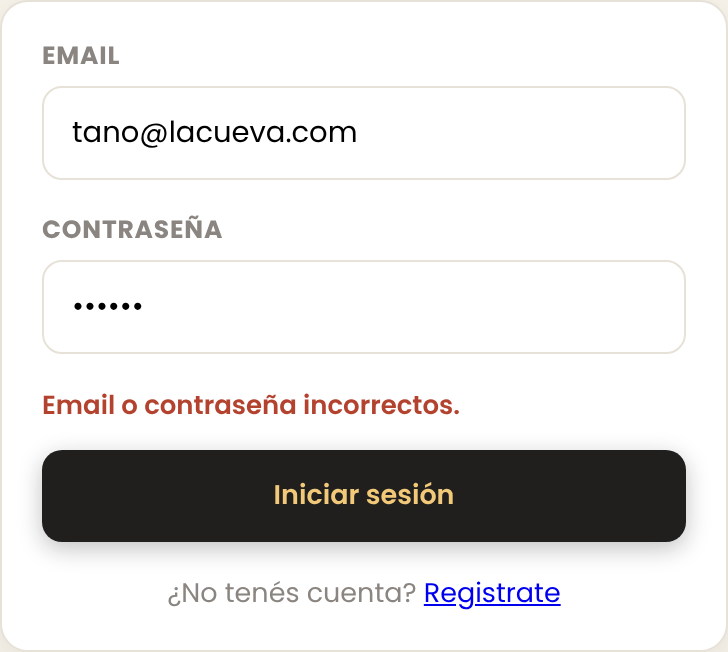 | 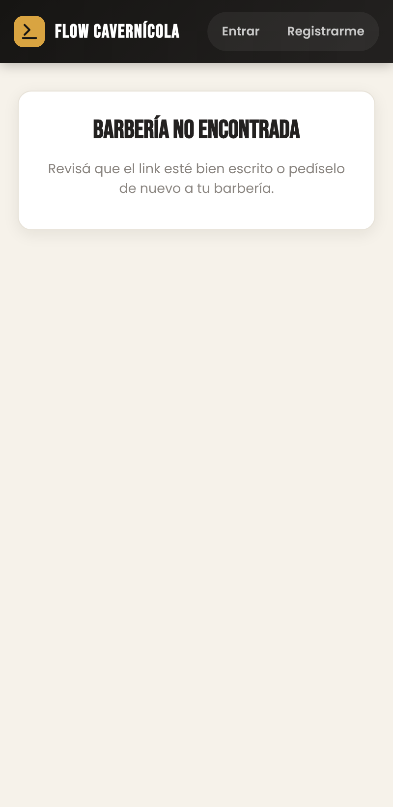 |

## 9. Qué agregué al código en esta etapa

- `supabase/schema.sql`, sección 9: las funciones `horarios_disponibles` y `reservar_turno`, y los permisos para llamarlas sin cuenta.
- `supabase/actualizacion.sql`: lo mismo, para aplicarlo a una base que ya tenía datos sin borrar nada.
- La ruta `/reservar/:slug`, con la página de reserva conectada a la base. Antes usaba datos de ejemplo.
- La agenda y el formulario de turnos ahora usan `services/db.js` y las tablas de la Parte 5 (ids de cliente, servicio y barbero).
- `src/utils/validaciones.js`: control de formato de nombre, teléfono y email.
- Mensajes de éxito en la agenda, y el link propio de cada barbería con los botones "Copiar" y "Ver mi página".
- Un trigger que, al registrarse una barbería, le carga servicios y horarios de arranque.

## 10. Cómo probarlo

Los pasos para correrlo (con Supabase o en modo demo) y los usuarios de prueba están en el [README](../README.md).

## 11. Lo que queda para la próxima etapa

- Recordatorio automático por WhatsApp unas horas antes del turno.
- Pantallas para que el barbero edite sus servicios, precios y horarios. Hoy quedan los de arranque.
- Sumar barberos empleados desde la app.
- Publicarlo en Vercel para tener un link real para compartir.
