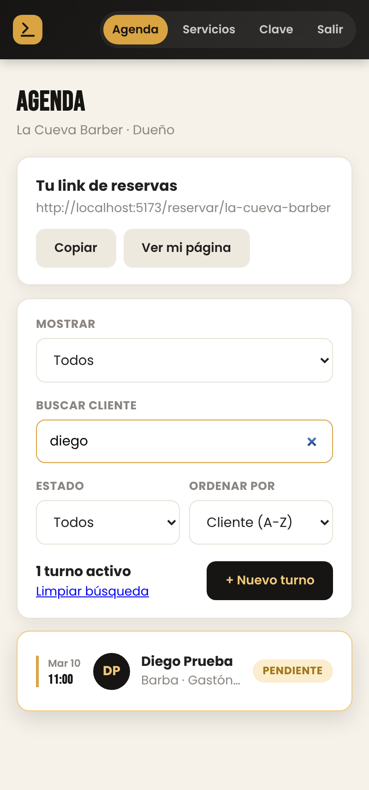
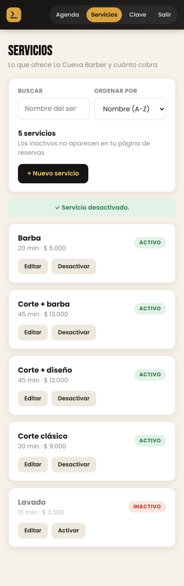
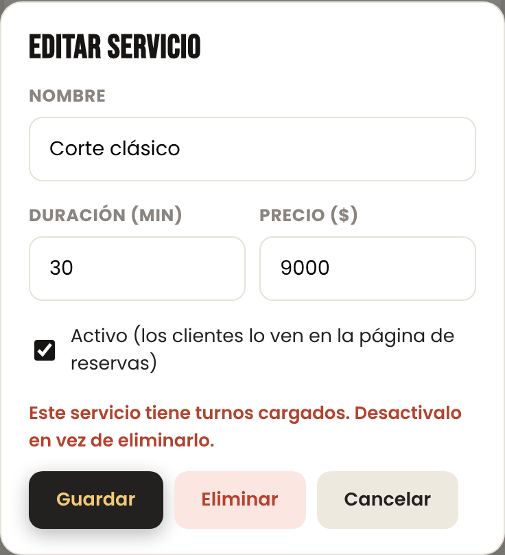
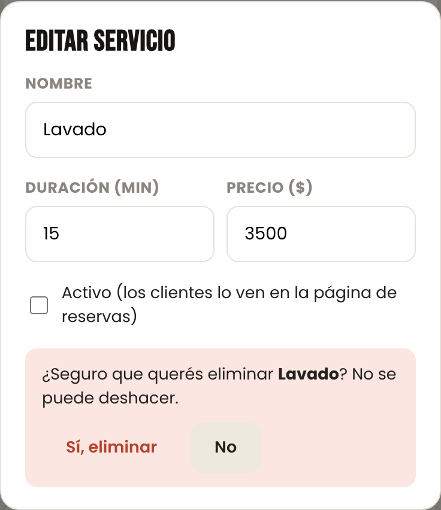
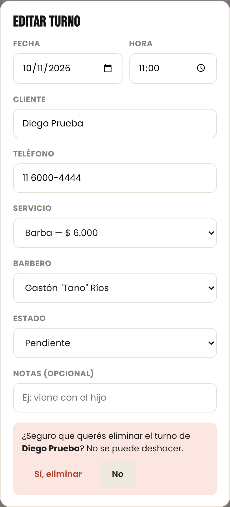
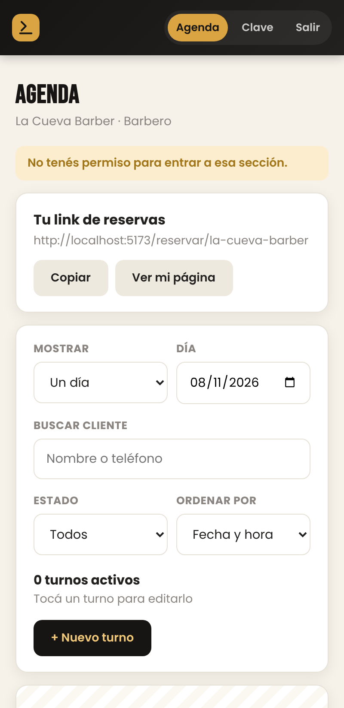
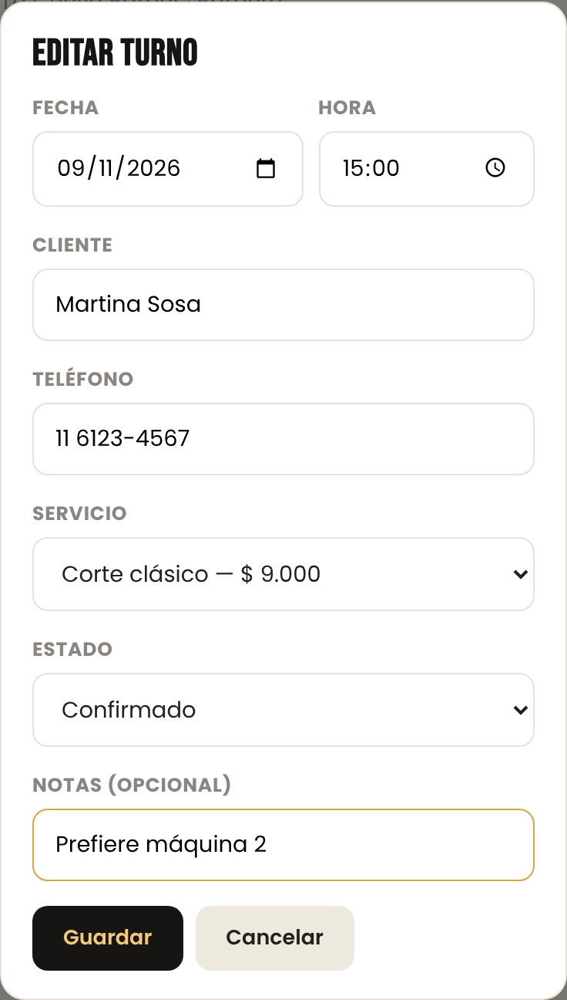
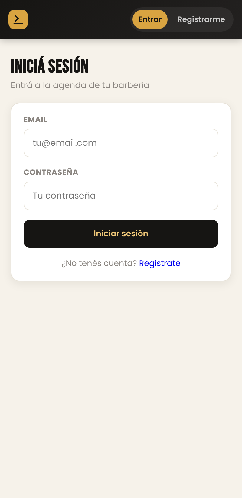

# Flow Cavernícola — SaaS Parte 7: Gestión completa, roles y permisos

**Alumno:** Tobias Juárez · **Curso:** 7° 3ª · **Materia:** PDISC 7.6
**Tecnología:** Vue 3 + Vue Router + Supabase (PostgreSQL, Auth y Row Level Security)

---

## 1. Qué información administra el usuario y qué faltaba

| Información | Quién la administra | Cómo estaba en la Parte 6 | Qué agregué en la Parte 7 |
|---|---|---|---|
| **Turnos** | Dueño y barberos | Alta, edición y baja, pero viendo un solo día y sin poder buscar | Búsqueda por cliente o teléfono, filtro por período y estado, orden, confirmación antes de eliminar y permisos según el rol |
| **Servicios** (nombre, duración y precio) | Dueño | Quedaban los de arranque: no se podían cambiar | ABM completo: alta, edición, activar/desactivar, baja, búsqueda y orden |
| **Clientes** | Dueño y barberos | Se crean solos al reservar o al cargar un turno | Se corrigen desde el turno. Solo el dueño puede borrarlos (en la base) |
| **Horarios y datos de la barbería** | Dueño | Quedan los de arranque | En la base ya solo el dueño puede cambiarlos. La pantalla queda para la próxima etapa |

## 2. Operaciones: crear, consultar, modificar y eliminar

| Módulo | Crear | Consultar | Modificar | Eliminar |
|---|---|---|---|---|
| **Turnos** (`/agenda`) | "+ Nuevo turno" | Agenda con búsqueda, filtros y orden | Tocando el turno: fecha, hora, cliente, servicio, barbero, estado y notas | Botón "Eliminar", con confirmación (solo el dueño) |
| **Servicios** (`/servicios`) | "+ Nuevo servicio" | Lista con búsqueda y orden | "Editar" (nombre, duración, precio, activo) y "Activar/Desactivar" | "Eliminar" dentro de Editar, con confirmación |

Todas las operaciones pasan por `src/services/db.js`: `listarTurnos`, `crearTurno`, `actualizarTurno`, `eliminarTurno`, `listarServicios`, `guardarServicio` y `eliminarServicio`.

## 3. Buscar, filtrar y ordenar

**En la agenda:**

| Control | Opciones | Dónde se resuelve |
|---|---|---|
| **Mostrar** | Un día (con calendario) · Próximos 7 días · Todos | En la base: `fecha >= desde` y `fecha <= hasta` |
| **Estado** | Todos · Pendiente · Confirmado · Completado · Cancelado | En la base: `estado = ...` |
| **Buscar cliente** | Nombre o teléfono. Ignora tildes, mayúsculas, espacios y guiones: "6000-4444" encuentra "11 6000-4444" | En la página, sobre lo que trajo la base |
| **Ordenar por** | Fecha y hora · Cliente (A-Z) · Estado | En la página |

El período y el estado se filtran en la consulta para no traer de más. La búsqueda por texto y el orden se hacen sobre ese resultado, que ya viene **solo con los turnos de la barbería del usuario**: lo filtra `barberia_id` y además lo garantiza RLS en la base.

**En servicios:** búsqueda por nombre y orden por nombre, precio o duración.

| Agenda: "Todos", buscando "diego", orden por cliente | Servicios (dueño) |
|:---:|:---:|
|  |  |

## 4. Mensajes, confirmación y las mismas reglas al modificar

**Siempre aviso qué pasó:** "✓ Turno creado.", "✓ Turno actualizado.", "✓ Turno eliminado.", "✓ Servicio creado.", "✓ Servicio actualizado.", "✓ Servicio desactivado.", "✓ Servicio activado." y "✓ Servicio eliminado."

**Antes de eliminar pido confirmación.** No uso el `confirm()` del navegador: el mismo formulario muestra un cuadro rojo con "¿Seguro que querés eliminar…? No se puede deshacer", y hay que tocar "Sí, eliminar".

**Al modificar se aplican las mismas reglas que al crear**, porque los dos caminos pasan por la misma validación (`validarServicio()`, `validarNombre()` y `validarTelefono()` en `src/utils/validaciones.js`) y por las mismas restricciones de la base:

| Regla | Dónde | Mensaje |
|---|---|---|
| Nombre de servicio obligatorio, de 2 a 40 caracteres | Página | "Completá el nombre del servicio." / "El nombre del servicio es muy corto." |
| Duración entera, entre 5 y 480 minutos | Página + `check (duracion_min > 0)` | "La duración tiene que ser un número entero de minutos, entre 5 y 480." |
| Precio entero y no negativo | Página + `check (precio >= 0)` | "El precio tiene que ser un número entero, sin puntos ni comas, y no puede ser negativo." |
| Precio obligatorio (también al editar) | Página | "Completá el precio." |
| No repetir el nombre del servicio en la barbería | `unique (barberia_id, nombre)` | "Ya tenés un servicio con ese nombre." |
| No borrar un servicio que tiene turnos | Clave foránea de `turnos` | "Este servicio tiene turnos cargados. Desactivalo en vez de eliminarlo." |
| Un barbero no tiene dos turnos a la misma hora | Índice `turnos_sin_pisar` | "Ese barbero ya tiene un turno ese día a esa hora." |
| Cliente y teléfono con formato válido | Página | Los mismos mensajes que en la Parte 6 |

| Servicio con turnos | Confirmación (servicio) | Confirmación (turno) |
|:---:|:---:|:---:|
|  |  |  |

## 5. Tipos de usuario

| Rol | Quién es | Qué necesita hacer | Por qué |
|---|---|---|---|
| **Dueño** (`dueno`) | El que registró la barbería. Hay uno solo por barbería. | Todo: ver la agenda completa, cargar, mover y eliminar cualquier turno, administrar los servicios y precios, y (próximamente) los horarios y los datos de la barbería. | Es el responsable del negocio: decide qué se ofrece, cuánto se cobra y cómo se organiza el equipo. |
| **Barbero** (`barbero`) | Un empleado de la barbería. | Ver la agenda de todos (para coordinar), cargar turnos para sí mismo y modificar o cancelar **sus** turnos. | Necesita manejar su día, pero no tiene que poder tocar los turnos de un compañero, borrar historial ni cambiar precios. |
| **Cliente** (sin cuenta) | Quien entra por el link de la barbería. | Ver servicios y horas libres, y reservar. | Pedirle una cuenta frenaría la reserva, que es justo lo que el SaaS quiere facilitar. Reserva por las funciones `horarios_disponibles` y `reservar_turno` (Parte 6). |

**En el modelo de datos de la Parte 5**, cada usuario con cuenta tiene una fila en `perfiles`:

- `perfiles.id` es el mismo id de `auth.users`. Así cada cuenta de Supabase Auth es un perfil.
- `perfiles.barberia_id` lo vincula a **una** barbería (clave foránea, obligatoria).
- `perfiles.rol` le asigna **un** rol (`check (rol in ('dueno', 'barbero'))`, obligatorio).
- El índice único `un_dueno_por_barberia` impide que haya dos dueños en la misma barbería.

Los clientes no tienen cuenta, pero quedan en la tabla `clientes` también atados a una barbería (`barberia_id`).

## 6. Permisos: en la pantalla y en la base de datos

| Acción | Dueño | Barbero | Dueño de otra barbería | Sin sesión |
|---|:---:|:---:|:---:|:---:|
| Ver la agenda y los clientes de la barbería | ✅ | ✅ | ❌ | ❌ |
| Crear turnos | ✅ (para cualquiera) | ✅ (solo para sí mismo) | ❌ | Solo reservando por el link |
| Modificar turnos | ✅ | ✅ (solo los suyos) | ❌ | ❌ |
| Eliminar turnos y clientes | ✅ | ❌ (puede cancelar) | ❌ | ❌ |
| Crear, editar o eliminar servicios | ✅ | ❌ | ❌ | ❌ |
| Cambiar horarios y datos de la barbería | ✅ | ❌ | ❌ | ❌ |
| Cambiarse el propio rol | ❌ | ❌ | ❌ | ❌ |

**En la pantalla** (para que el usuario no vea opciones que no puede usar):

- `router/index.js`: `/agenda` y `/cambiar-password` tienen `meta: { requiereAuth: true }`. `/servicios` además tiene `meta: { rol: "dueno" }`: si entra un barbero escribiendo la ruta, vuelve a la agenda con el aviso "No tenés permiso para entrar a esa sección."
- El menú muestra "Servicios" solo al dueño.
- En el formulario de turnos, el barbero no ve el selector de barbero ni el botón "Eliminar".
- Los turnos de otro barbero se ven, pero al tocarlos aparece "Solo podés modificar tus propios turnos."

**En la base de datos (lo que realmente protege).** Ocultar un botón no alcanza: alguien podría llamar a la API directo con su token. Por eso cada tabla tiene políticas de **Row Level Security** que usan dos funciones:

- `mi_barberia()`: la barbería del usuario logueado (sale de `auth.uid()`, no de lo que mande la página).
- `mi_rol()`: su rol. Si el perfil está desactivado devuelve null y pierde los permisos.

Ejemplo, la regla para modificar turnos (`supabase/schema.sql`, sección 7):

```sql
create policy "turnos: modificar (el barbero solo los suyos)"
  on public.turnos for update to authenticated
  using (
    barberia_id = public.mi_barberia()
    and (public.mi_rol() = 'dueno' or perfil_id = auth.uid())
  )
  with check (
    barberia_id = public.mi_barberia()
    and (public.mi_rol() = 'dueno' or perfil_id = auth.uid())
  );
```

El `using` decide **qué filas puede tocar** y el `with check` **cómo pueden quedar**. Así un barbero tampoco puede "pasarle" un turno suyo a otro barbero.

Para que nadie se suba de rol, la regla de `perfiles` exige `rol = mi_rol()`: cada uno puede editar sus datos, pero el rol tiene que quedar igual al que tenía.

**Un detalle de Supabase:** cuando RLS no deja modificar o borrar, no devuelve error: responde "OK, 0 filas". En `db.js` pido las filas afectadas y, si no vino ninguna, lo convierto en el error "No tenés permiso para hacer eso." (función `exigirFilas`). Así la pantalla nunca dice "guardado" cuando en realidad no se guardó nada.

| Barbero que entra a /servicios | Barbero editando un turno suyo |
|:---:|:---:|
|  |  |

## 7. Sesión cerrada o vencida

- **Antes de cada cambio de página**, el `router.beforeEach` pide la sesión con `supabase.auth.getSession()`. Si se cerró o venció y no se pudo renovar, devuelve null y cualquier ruta privada redirige a `/login?redirect=...`, aunque la escriban a mano en la barra de direcciones.
- **Si la sesión se termina con la página abierta**, `App.vue` escucha `onAuthStateChange` y manda al login si el usuario estaba en una pantalla privada.
- **Aunque alguien tuviera la pantalla vieja abierta**, la base no le devuelve nada: sin token válido es un usuario anónimo, y RLS no le deja ver turnos ni clientes.



## 8. Pruebas con cuentas de distintos roles y organizaciones

Hice las pruebas el 8/11/2026 contra la base real de Supabase, con tres cuentas del `seed.sql`:

- **Tano** (`tano@lacueva.com`): dueño de La Cueva Barber.
- **Rulo** (`rulo@lacueva.com`): barbero de La Cueva Barber.
- **Nico** (`nico@eltano.com`): dueño de otra barbería, Barbería El Tano.

Probé **desde la pantalla** y también **contra la API directa**: un `fetch` a Supabase con el token del usuario, que es lo que haría alguien que quiere saltearse la página. En la API, "0 filas" significa que Supabase contestó pero RLS no dejó tocar nada, y "403 (42501)" que la base rechazó la operación por permisos.

### Dueño (Tano)

| # | Qué hice | Resultado | |
|---|---|---|---|
| D1 | Entré a la agenda | Dice "La Cueva Barber · Dueño" y el menú muestra Agenda, **Servicios**, Clave y Salir | ✅ Permitido |
| D2 | Cargué un turno para mí (Diego Prueba, mar 10/11, 11:00) | "✓ Turno creado." | ✅ Permitido |
| D3 | "Todos" + buscar "diego" / "6000-4444" / estado "cancelado" / ordenar por cliente | 1 resultado / 1 resultado / solo cancelados / orden A-Z correcto | ✅ |
| D4 | Nuevo servicio "Barba" (ya existe) | "Ya tenés un servicio con ese nombre." | ✅ Bloqueado |
| D5 | Nuevo servicio con precio -5 / con duración 2 | Mensaje de precio / mensaje de duración | ✅ Bloqueado |
| D6 | Nuevo servicio "Lavado", 15 min, $3000 | "✓ Servicio creado." | ✅ Permitido |
| D7 | Edité "Lavado" borrando el precio | "Completá el precio." (la misma regla que al crear) | ✅ Bloqueado |
| D8 | Edité "Lavado" a $3500 y después lo desactivé | "✓ Servicio actualizado." y "✓ Servicio desactivado." | ✅ Permitido |
| D9 | Eliminé "Corte clásico", que tiene turnos | "Este servicio tiene turnos cargados. Desactivalo en vez de eliminarlo." | ✅ Bloqueado por la base |
| D10 | Eliminé "Lavado" | Pidió confirmación y después "✓ Servicio eliminado." | ✅ Permitido |
| D11 | Eliminé el turno de Diego | Pidió confirmación y después "✓ Turno eliminado." | ✅ Permitido |

### Barbero (Rulo)

| # | Qué hice | Por | Resultado | |
|---|---|---|---|---|
| B1 | Entré a la agenda | Pantalla | "La Cueva Barber · Barbero". El menú **no** muestra Servicios | ✅ |
| B2 | Escribí `/servicios` en la barra | Pantalla | Volvió a la agenda: "No tenés permiso para entrar a esa sección." | ✅ Bloqueado |
| B3 | Toqué el turno de Diego (es de Tano) | Pantalla | "Solo podés modificar tus propios turnos." No se abre el formulario | ✅ Bloqueado |
| B4 | Edité un turno mío (Martina Sosa, le agregué una nota) | Pantalla | El formulario no tiene "Barbero" ni "Eliminar". "✓ Turno actualizado." | ✅ Permitido |
| B5 | Borrar un turno mío | API | 0 filas | ✅ Bloqueado |
| B6 | Cancelar el turno de Tano | API | 0 filas | ✅ Bloqueado |
| B7 | Crear un turno a nombre de Tano | API | 403 (42501) | ✅ Bloqueado |
| B8 | Cambiar el precio de los servicios | API | 0 filas | ✅ Bloqueado |
| B9 | Crear un servicio | API | 403 (42501) | ✅ Bloqueado |
| B10 | Cambiarme el rol a "dueno" | API | 403 (42501) | ✅ Bloqueado |

### Dueño de otra barbería (Nico)

| # | Qué hice | Por | Resultado | |
|---|---|---|---|---|
| O1 | Entré a la agenda y busqué "diego" en "Todos" | Pantalla | "Barbería El Tano · Dueño", 0 resultados: no ve los turnos de La Cueva | ✅ Bloqueado |
| O2 | Leer los turnos de La Cueva | API | 0 filas | ✅ Bloqueado |
| O3 | Leer los clientes de La Cueva | API | 0 filas | ✅ Bloqueado |
| O4 | Cancelar un turno de La Cueva | API | 0 filas | ✅ Bloqueado |
| O5 | Borrar los servicios de La Cueva | API | 0 filas | ✅ Bloqueado |
| O6 | Crear un turno dentro de La Cueva | API | 403 (42501) | ✅ Bloqueado |

### Sesión

| # | Qué hice | Resultado | |
|---|---|---|---|
| S1 | Rulo cerró sesión y escribí `/agenda` | Redirige a `/login?redirect=/agenda` | ✅ Bloqueado |
| S2 | Sin sesión, escribí `/servicios` | Redirige a `/login?redirect=/servicios` | ✅ Bloqueado |
| S3 | Con la sesión abierta, borré la sesión guardada en el navegador (como cuando vence) y fui a `/agenda` | Redirige a `/login?redirect=/agenda` | ✅ Bloqueado |

También comprobé las mismas reglas directamente en PostgreSQL, simulando a cada usuario, antes de aplicarlas a Supabase.

## 9. Qué cambié en el código

- `supabase/schema.sql`, sección 7: la función `mi_rol()` y las reglas de RLS por rol, reescritas tabla por tabla.
- `supabase/actualizacion-parte7.sql`: lo mismo, para aplicarlo a una base que ya tenía datos sin borrar nada.
- `src/services/db.js`: `listarTurnos()` con filtros, `guardarServicio()`, `eliminarServicio()` y `exigirFilas()`, para detectar cuando RLS no deja tocar nada.
- `src/views/AgendaBarbero.vue`: período, búsqueda, estado, orden y permisos según el rol.
- `src/components/TurnoForm.vue`: lo que se muestra según el rol y la confirmación antes de eliminar.
- `src/views/ServiciosView.vue` y `src/components/ServicioForm.vue`: el ABM de servicios.
- `src/router/index.js`: la ruta `/servicios`, solo para el dueño.
- `src/App.vue`: el menú según el rol, y la salida al login si la sesión termina.
- `src/utils/buscar.js` y `validarServicio()` en `src/utils/validaciones.js`.
- `src/services/dbDemo.js`: las mismas funciones para el modo demo.

## 10. Lo que queda para la próxima etapa

- Pantallas para editar los horarios y los datos de la barbería. Los permisos en la base ya están listos: solo el dueño.
- Que el dueño pueda invitar barberos desde la app. Hoy los empleados se cargan desde la base, como Rulo en `seed.sql`.
- Recordatorio automático por WhatsApp y publicación en Vercel.
