# Flow Cavernícola — SaaS Parte Final: roles, pruebas y publicación

**Alumno:** Tobias Juárez · **Curso:** 7° 3ª · **Materia:** PDISC 7.6
**Tecnología:** Vue 3 + Vue Router + Supabase (PostgreSQL, Auth y Row Level Security) · Publicado en Vercel

> **Link de prueba:** https://flow-cavernicola.vercel.app
> **Página de reservas de ejemplo:** https://flow-cavernicola.vercel.app/reservar/la-cueva-barber
> **Repositorio:** https://github.com/tobiasjuarezz/flow-cavernicola
>
> Cuentas de demostración (datos ficticios, contraseña `123456` en las tres):
> `tano@lacueva.com` (dueño) · `rulo@lacueva.com` (barbero) · `nico@eltano.com` (dueño de otra barbería)

---

## 1. Roles del sistema

| Rol | Quién es | Qué tareas necesita hacer |
|---|---|---|
| **Dueño** (`dueno`) | El que registró la barbería. Hay uno solo por barbería. | Ver la agenda completa; cargar, mover, cancelar y eliminar cualquier turno; administrar servicios y precios; editar los datos de la barbería y los horarios de cada barbero; compartir el link de reservas. |
| **Barbero** (`barbero`) | Empleado de la barbería. | Ver la agenda de todos (para coordinar), cargar turnos para sí mismo y modificar o cancelar **solo sus** turnos. |
| **Cliente** (sin cuenta) | Quien entra por el link de la barbería. | Ver los servicios y las horas libres, y reservar dejando nombre y WhatsApp. |

El cliente no tiene cuenta a propósito: pedirle registrarse frenaría la reserva, que es justo lo que el SaaS quiere facilitar.

## 2. Matriz de permisos

| Acción | Rol 1: **Dueño** | Rol 2: **Barbero** | Rol 3: **Cliente** (sin cuenta) |
|---|:---:|:---:|:---:|
| Consultar turnos y clientes de su barbería | Sí | Sí | No |
| Crear turnos | Sí (para cualquier barbero) | Sí (solo para sí mismo) | Sí, solo reservando por el link |
| Modificar turnos | Sí | Sí (solo los suyos) | No |
| Eliminar turnos y clientes | Sí | No (los puede cancelar) | No |
| Consultar servicios | Sí | Sí | Sí (los activos, en la página de reservas) |
| Crear, modificar y eliminar servicios | Sí | No | No |
| Consultar horarios | Sí | Sí | Sí (solo las horas libres) |
| Crear, modificar y eliminar horarios | Sí | No | No |
| Modificar datos de la barbería (nombre, teléfono, dirección) | Sí | No | No |
| Cambiar el plan o el link de la barbería | No (desde la app nadie) | No | No |
| Gestión de usuarios: cambiar su propio rol | No | No | No |
| Gestión de usuarios: dar de alta barberos | Desde la base (ver sección 17) | No | No |
| Cambiar su propia contraseña | Sí | Sí | No tiene cuenta |
| Ver o tocar datos de **otra** barbería | No | No | No |

## 3. Usuarios, roles y organizaciones vinculados

Según el modelo de datos de la Parte 5, cada cuenta con login tiene **una** fila en `perfiles`:

- `perfiles.id` es el mismo id de `auth.users` (la cuenta de Supabase Auth).
- `perfiles.barberia_id` es **obligatorio** (`not null`) y es clave foránea a `barberias`: no puede existir una cuenta sin organización.
- `perfiles.rol` es **obligatorio** y solo acepta `'dueno'` o `'barbero'` (`check`).
- El índice único `un_dueno_por_barberia` impide dos dueños en la misma barbería.
- Al registrarse, el trigger `al_registrarse_usuario` crea en el mismo momento la barbería, el perfil con rol `dueno`, y servicios y horarios de arranque. No queda ninguna cuenta "suelta".

En la base de demostración hay 3 perfiles y los 3 tienen barbería y rol: Tano (dueño, La Cueva Barber), Rulo (barbero, La Cueva Barber) y Nico (dueño, Barbería El Tano).

## 4. Controles de acceso: en la pantalla **y** en la base

Ocultar botones no alcanza: cualquiera puede llamar a la API de Supabase directo con su token. Por eso cada regla está en dos lugares:

| Capa | Qué hace | Dónde |
|---|---|---|
| **Rutas** | `/agenda`, `/servicios`, `/mi-barberia` y `/cambiar-password` piden sesión. `/servicios` y `/mi-barberia` además piden rol `dueno`: si entra otro rol escribiendo la ruta, vuelve a la agenda con "No tenés permiso para entrar a esa sección." | `src/router/index.js` |
| **Menú y botones** | El dueño ve Agenda · Servicios · Barbería · Salir. El barbero ve Agenda · Clave · Salir. El barbero no ve "Eliminar" ni el selector de barbero en los turnos. | `src/App.vue`, `TurnoForm.vue` |
| **Base: filas (RLS)** | Cada tabla tiene políticas que usan `mi_barberia()` y `mi_rol()`, que salen del token (`auth.uid()`), no de lo que mande la página. | `supabase/schema.sql`, sección 7 |
| **Base: columnas** *(nuevo)* | De `barberias` solo se pueden modificar `nombre`, `telefono` y `direccion`. El `plan` y el `slug` no. | `actualizacion-final.sql` |
| **Base: reglas de datos** *(nuevo)* | El trigger `horarios_sin_superponer` no deja guardar dos franjas que se pisen para el mismo barbero y día. | `actualizacion-final.sql` |

**Problema de seguridad que encontré en esta etapa:** la política de RLS dejaba que el dueño modificara *su* barbería, pero no decía *qué columnas*. Probándolo contra la API, el dueño podía cambiarse el plan de "gratis" a "empresa" sin pagar. Lo arreglé con permisos por columna:

```sql
revoke update on public.barberias from anon, authenticated;
grant update (nombre, telefono, direccion) on public.barberias to authenticated;
```

RLS decide **qué filas** puede tocar cada uno, y los permisos por columna deciden **qué datos** de esa fila. Ahora el mismo intento devuelve `403 (42501)`.

## 5. Separación de la información entre barberías

- Todas las tablas tienen `barberia_id`, y las claves foráneas compuestas (Parte 5) impiden, por ejemplo, un turno de La Cueva con un servicio de El Tano.
- Las políticas filtran siempre por `barberia_id = mi_barberia()`. Un usuario de otra barbería, aunque llame a la API con el id correcto, recibe **0 filas** (lectura, modificación o baja) o **403** (alta).
- El cliente sin cuenta solo puede usar dos funciones públicas, `horarios_disponibles` y `reservar_turno`, que trabajan sobre la barbería del link.

Lo comprobé en las pruebas O1 (pantalla) y A6-A7 (API) de las secciones 8 y 9.

## 6. Sesiones y permisos

- Antes de cada cambio de página, el router pide la sesión (`supabase.auth.getSession()`). Si se cerró o venció, cualquier ruta privada manda a `/login?redirect=...`, aunque la escriban a mano.
- Si la sesión se termina con la página abierta, `App.vue` lo detecta (`onAuthStateChange`) y manda al login.
- Sin token válido, la base trata al usuario como anónimo y RLS no le devuelve turnos ni clientes.

Resultados: casos S1-S3 y P1-P3 (sección 8).

## 7. Casos de prueba

Los escribí antes de probar. Cada uno se ejecutó **dos veces, en tamaño compu (1280 px) y en tamaño celular (375 px)**, sobre la versión publicada en Vercel con la base real de Supabase (16/11/2026). Los recorridos los automaticé con Playwright, para que cada prueba siga exactamente los mismos pasos.

| # | Grupo | Pasos | Resultado esperado |
|---|---|---|---|
| S1 | Sesión | Sin sesión, escribir `/agenda` en la barra | Redirige al login |
| S2 | Sesión | Sin sesión, escribir `/mi-barberia` | Redirige al login |
| S3 | Sesión | Cerrar sesión y volver a `/agenda` | Redirige al login |
| R1 | Recorrido | Registrarse con barbería, nombre, email y contraseña | Entra a la agenda de su barbería nueva |
| R2 | Recorrido | Como cliente: abrir `/reservar/la-cueva-barber`, elegir servicio, día y hora, completar nombre y WhatsApp, "Confirmar turno" | Pantalla "¡Turno reservado!" |
| R3 | Recorrido | Iniciar sesión como Tano | Entra a la agenda |
| R4 | Recorrido | Agenda → "Próximos 7 días" | Aparece el turno reservado en R2 |
| R5 | Recorrido | Tocar el turno → estado "confirmado" → Guardar | "✓ Turno actualizado." |
| R6 | Recorrido | Servicios → "+ Nuevo servicio" → nombre, 30 min, $5000 | "✓ Servicio creado." |
| R7 | Recorrido | "Salir" | Vuelve al login |
| P1 | Permisos | Entrar como Rulo (barbero) y mirar el menú | No aparecen Servicios ni Barbería |
| P2 | Permisos | Como Rulo, escribir `/mi-barberia` | Vuelve a la agenda con aviso de permiso |
| P3 | Permisos | Como Rulo, escribir `/servicios` | Vuelve a la agenda |
| O1 | Separación | Entrar como Nico (El Tano) y ver la semana | No aparece el turno de La Cueva |
| E1-E13 | Datos incorrectos | Ver sección 9 | Mensaje claro, sin guardar nada |
| A1-A9 | API directa | Llamar a Supabase con el token de cada usuario, salteando la página | La base rechaza lo que no corresponde |

## 8. Recorridos principales, sesiones y roles: resultados

| # | Resultado obtenido (compu y celu) | |
|---|---|---|
| S1 | `/login?redirect=/agenda` | ✅ |
| S2 | `/login?redirect=/mi-barberia` | ✅ |
| S3 | `/login?redirect=/agenda` | ✅ |
| R1 | Entró a `/agenda` con la barbería nueva *(probado en modo demo para no llenar la base real de cuentas de prueba)* | ✅ |
| R2 | "¡Turno reservado!" con nombre, barbería, día y hora | ✅ |
| R3 | Entró a `/agenda` como "La Cueva Barber · Dueño" | ✅ |
| R4 | 41 turnos en la semana, entre ellos el de "Martín Gómez" | ✅ |
| R5 | "✓ Turno actualizado." | ✅ |
| R6 | "✓ Servicio creado." | ✅ |
| R7 | Volvió a `/login` | ✅ |
| P1 | Menú de Rulo: "Agenda · Clave · Salir" | ✅ |
| P2 | `/agenda?aviso=sin-permiso` y "No tenés permiso para entrar a esa sección." | ✅ |
| P3 | `/agenda?aviso=sin-permiso` | ✅ |
| O1 | Turnos de "Martín Gómez" visibles para Nico: 0 | ✅ |

| Agenda del dueño (compu) | Agenda en el celu | Barbero que escribe `/mi-barberia` |
|:---:|:---:|:---:|
| 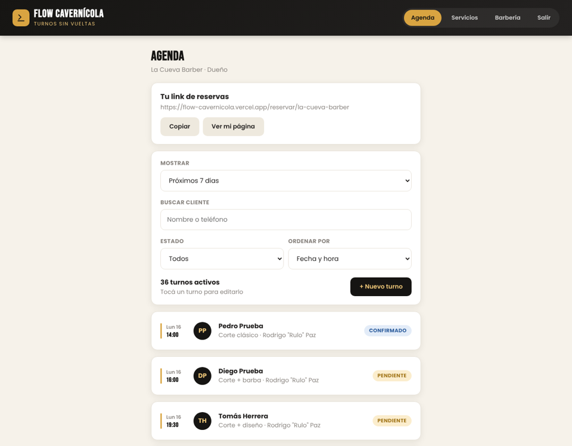 | 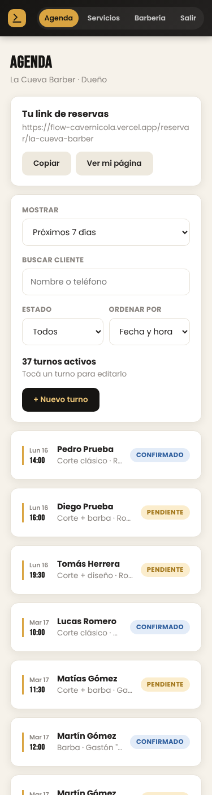 | 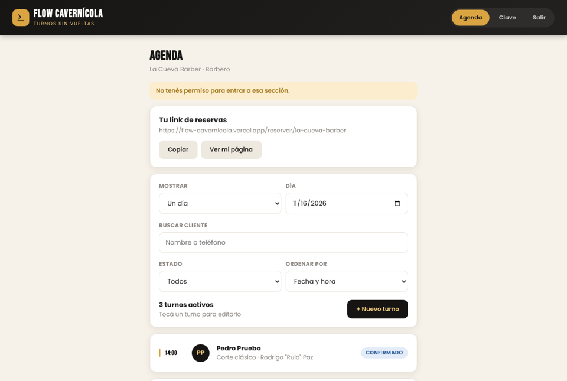 |

| Reserva del cliente (celu) | Turno reservado |
|:---:|:---:|
| 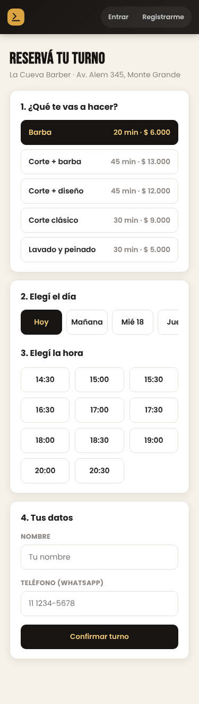 | 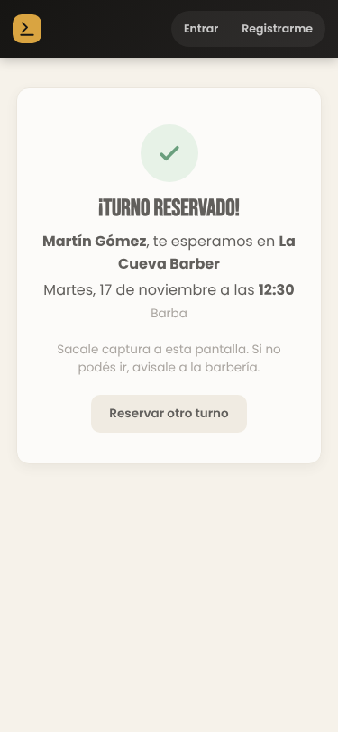 |

## 9. Datos incorrectos y situaciones de error

### Desde la pantalla (compu y celu)

| # | Qué ingresé | Respuesta del sistema | |
|---|---|---|---|
| E1 | Login con email y contraseña vacíos | "Completá tu email y tu contraseña." | ✅ |
| E2 | Login con email `tano-arroba-gmail` | "El email no tiene un formato válido." | ✅ |
| E3 | Login con contraseña incorrecta | "Email o contraseña incorrectos." | ✅ |
| E4 | Registro con todo vacío | "Completá todos los campos." | ✅ |
| E5 | Registro con contraseñas distintas | "Las contraseñas no coinciden." | ✅ |
| E6 | Registro con contraseña de 3 caracteres | "La contraseña tiene que tener al menos 6 caracteres." | ✅ |
| E7 | Abrir `/reservar/no-existe-esta` | "Barbería no encontrada" | ✅ |
| E8 | Abrir `/cualquier-cosa/123` | Vuelve al inicio (al login si no hay sesión) | ✅ |
| E9 | Reservar con nombre y teléfono vacíos | "Completá el nombre." | ✅ |
| E10 | Reservar con teléfono `11-abc` | "El teléfono solo puede tener números, espacios, guiones o +." | ✅ |
| E11 | Buscar en la agenda un cliente que no existe | "No hay turnos que coincidan con la búsqueda." | ✅ |
| E12 | Servicio con precio `-500` | "El precio tiene que ser un número entero, sin puntos ni comas, y no puede ser negativo." | ✅ |
| E13 | Franja martes 12:00-15:00 cuando ya hay martes 10:00-20:00 | "Esa franja se superpone con otra del mismo barbero ese día." | ✅ |

En la pantalla "Mi barbería" también probé: hora de fin antes que la de inicio ("La hora de fin tiene que ser después de la de inicio."), una franja a las 10:15 ("Usá horas en punto o y media...") y un teléfono con letras.

| Login con error | Registro con error | Teléfono inválido al reservar | Búsqueda sin resultados |
|:---:|:---:|:---:|:---:|
| 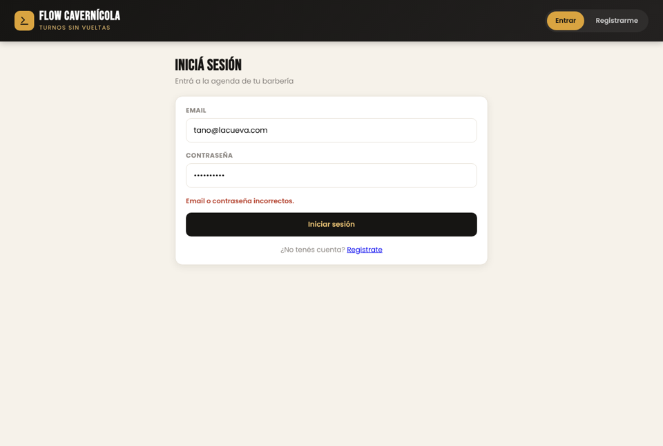 | 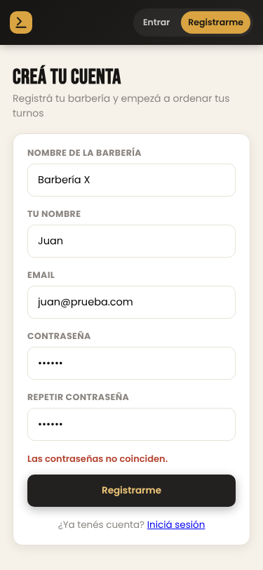 | 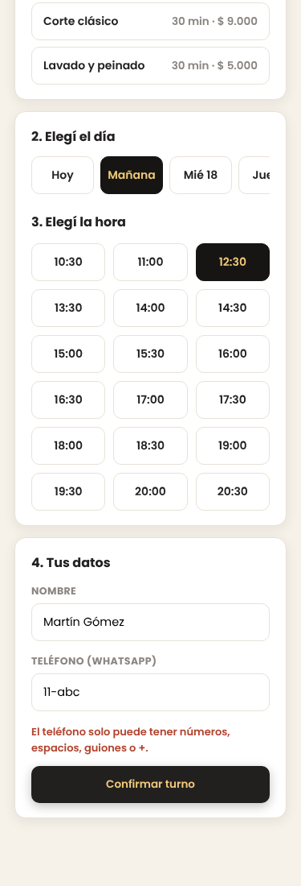 | 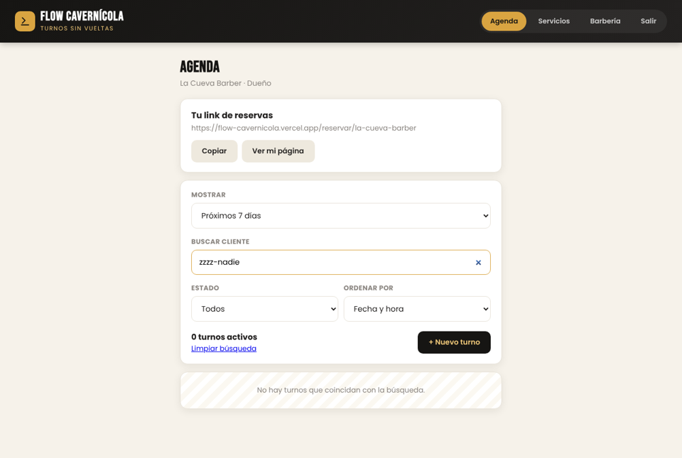 |

### Contra la API, salteando la página (base real)

| # | Qué intenté | Respuesta de Supabase | |
|---|---|---|---|
| A1 | Tano se cambia el plan a "empresa" | `403 (42501)` permiso denegado | ✅ Bloqueado |
| A2 | Tano cambia el link (slug) de su barbería | `403 (42501)` | ✅ Bloqueado |
| A3 | Tano cambia el teléfono de su barbería | `200`, guardado | ✅ Permitido |
| A4 | Rulo (barbero) cambia el nombre de la barbería | `200` pero **0 filas**: RLS no lo dejó | ✅ Bloqueado |
| A5 | Rulo se agrega un horario | `403 (42501)` | ✅ Bloqueado |
| A6 | Nico agrega un horario en La Cueva | `403 (42501)` | ✅ Bloqueado |
| A7 | Nico borra los horarios de La Cueva | `200` pero **0 filas** | ✅ Bloqueado |
| A8 | Tano carga una franja que se pisa (martes 9-11) | `400 (23P01)` "La franja se superpone..." | ✅ Bloqueado |
| A9 | Sin sesión, modificar una barbería | `401 (42501)` | ✅ Bloqueado |

Antes de tocar la base real, corrí las mismas reglas en un PostgreSQL local con el mismo esquema, simulando a cada usuario (18 casos más, todos con el resultado esperado).

## 10. Visualización en compu y celular

Revisé cada pantalla en 1280 px y en 375 px (tamaño de un celular). Los mensajes aparecen debajo del formulario, en rojo los errores y en verde con ✓ lo que salió bien, y cada botón dice qué hace ("Guardar datos", "+ Agregar franja", "Sí, eliminar").

Encontré tres problemas de visualización en el celu y los corregí (sección 11, problemas 6 a 8).

| Mi barbería (compu) | Mi barbería (celu) | Servicios (celu) | Barbería inexistente |
|:---:|:---:|:---:|:---:|
| 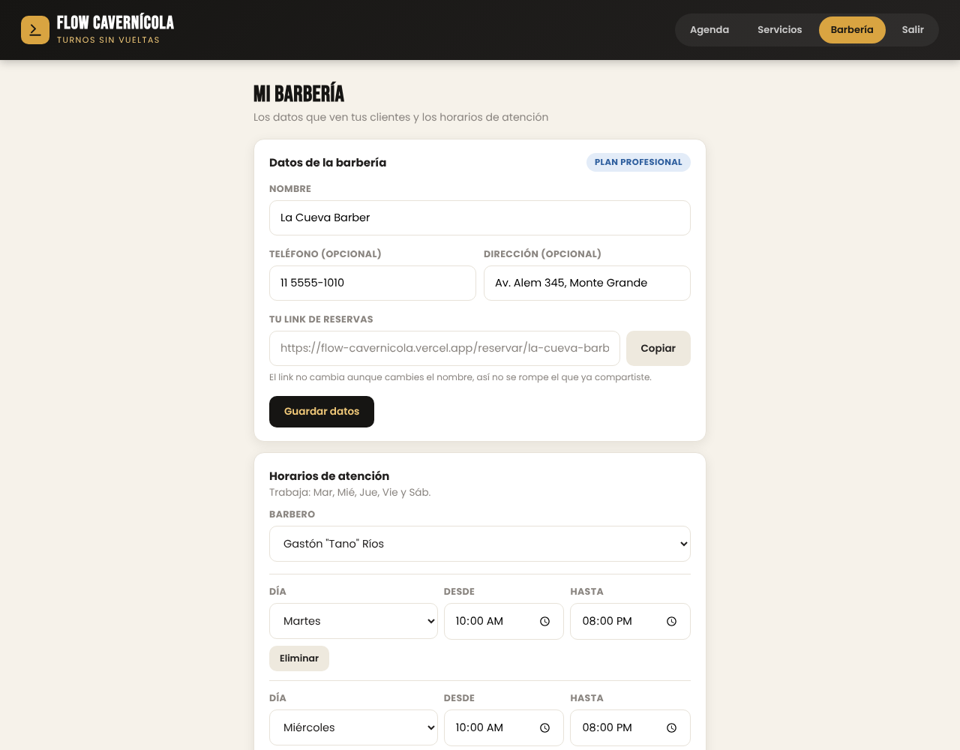 | 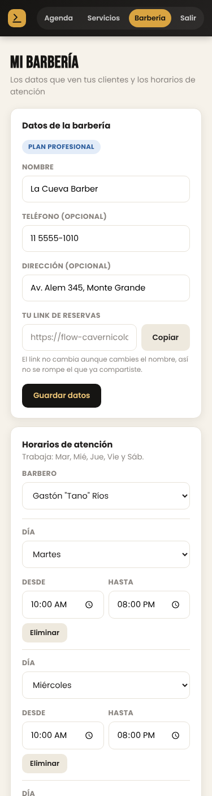 | 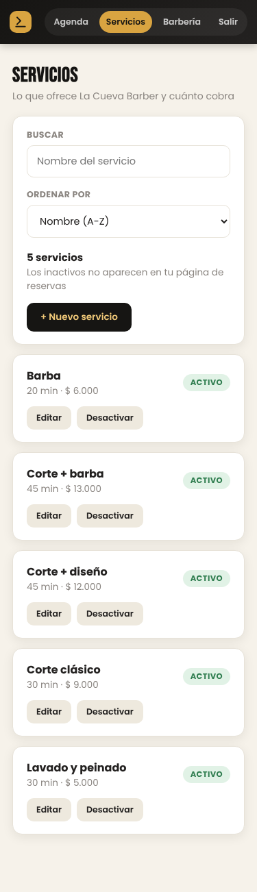 | 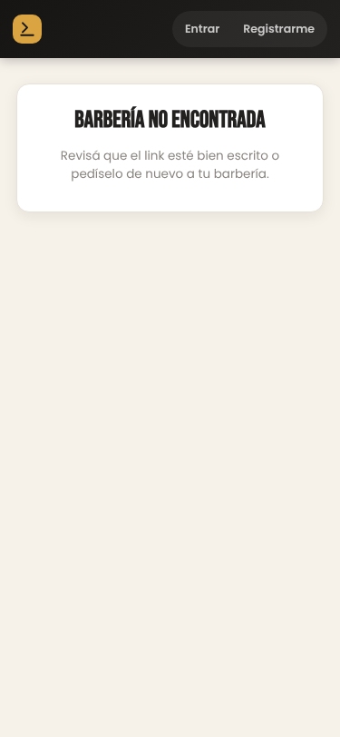 |

## 11. Problemas registrados y corregidos

| # | Problema | Cómo lo encontré | Corrección | Estado |
|---|---|---|---|---|
| 1 | Publicado en Vercel, entrar directo a `/agenda` o recargar daba **404** | Revisando la configuración antes de publicar (Vue Router usa rutas "de mentira" que el servidor no conoce) | `vercel.json` que devuelve `index.html` para cualquier ruta | ✅ Las 6 rutas probadas responden 200 |
| 2 | La demo aparecía **vacía**: los turnos del seed eran de octubre | Mirando la base: 0 turnos desde hoy | `supabase/datos-demo.sql`: turnos ficticios para hoy y los próximos 6 días, respetando los horarios. Se puede correr varias veces sin duplicar | ✅ 49 turnos en la semana |
| 3 | El dueño podía **cambiarse el plan** llamando a la API | Prueba A1 contra la base | Permisos por columna en `barberias` | ✅ Ahora `403` |
| 4 | Los horarios solo se podían cambiar **desde la base** | Pendiente de la Parte 7 | Pantalla nueva "Mi barbería" (`/mi-barberia`) con ABM de horarios por barbero y datos de la barbería | ✅ |
| 5 | Se podían cargar **franjas superpuestas** | Probando la pantalla nueva | Validación en la página + trigger `horarios_sin_superponer` en la base | ✅ Prueba E13 y A8 |
| 6 | En el celu, las horas de "Mi barbería" se cortaban ("10:(") | Revisión en 375 px | En pantallas chicas el día ocupa toda la fila y las horas van de a dos | ✅ |
| 7 | En el celu, el nombre del cliente en la agenda se cortaba ("Martín G...") | Revisión en 375 px | En pantallas chicas se oculta el círculo con iniciales | ✅ |
| 8 | En el celu, el buscador de servicios quedaba muy angosto | Revisión en 375 px | El buscador y el orden van uno abajo del otro | ✅ |
| 9 | Con la opción nueva, el menú del dueño no entraba en el celu (5 opciones) | Revisión en 375 px | "Cambiar contraseña" del dueño pasó adentro de "Mi barbería": el menú queda en 4 opciones | ✅ |
| 10 | `datos-demo.sql` contaba los días distinto que la función de reservas (el domingo no coincidía) | Revisando el script antes de correrlo | Uso `extract(dow)`, igual que `horarios_disponibles` | ✅ |

## 12. Versión de demostración

- **2 barberías** ficticias: La Cueva Barber (plan profesional, 2 barberos) y Barbería El Tano (plan gratis).
- **3 cuentas** de prueba (las de arriba), una por cada tipo de usuario con login.
- **Servicios** con precio y duración, **horarios** por barbero y **19 clientes** ficticios.
- **Turnos para toda la semana** en distintos estados (pendiente, confirmado, completado y cancelado), cargados con `datos-demo.sql`.

Antes de la presentación hay que volver a correr `supabase/datos-demo.sql` en el SQL Editor de Supabase, así hay turnos para ese día. No borra nada y no duplica.

## 13. Publicación

Seguí la arquitectura de la etapa 3: **frontend en Vercel** y **base de datos y login en Supabase Cloud**.

1. Subí el código a GitHub (`tobiasjuarezz/flow-cavernicola`).
2. En Supabase corrí `actualizacion-final.sql` (arreglos de esta etapa) y `datos-demo.sql`.
3. En Vercel importé el repositorio (Vercel detecta Vite solo: `npm run build`, carpeta `dist`) y cargué dos variables de entorno: `VITE_SUPABASE_URL` y `VITE_SUPABASE_ANON_KEY`.
4. Cada vez que subo un cambio a la rama `main`, Vercel lo vuelve a publicar solo.

**Comprobación desde otro dispositivo:** abrí el sistema desde otra computadora, distinta de la mía, en tamaño compu y celular, y corrí ahí todas las pruebas de la sección 8. Las rutas principales responden al entrar directo:

| Ruta | Respuesta |
|---|---|
| `/` | 200 |
| `/agenda` | 200 (sin sesión, la app manda al login) |
| `/mi-barberia` | 200 (sin sesión, la app manda al login) |
| `/reservar/la-cueva-barber` | 200 |
| `/confirmacion` | 200 |
| `/cualquier/cosa` | 200 (la app vuelve al inicio) |

## 14. Revisión de la configuración antes de compartir

| Qué revisé | Resultado |
|---|---|
| ¿Hay contraseñas o claves en el repositorio? | No. El `.env` está en `.gitignore` y nunca se subió (revisé el historial). En el repo solo está `.env.example` con valores de ejemplo. |
| ¿Qué claves usa la página publicada? | Solo la URL y la **anon key** de Supabase, que son públicas a propósito: van dentro de la página y lo que protege los datos es RLS. Están cargadas como variables de entorno en Vercel, no en el código. |
| ¿Se usa la `service_role` (la clave que saltea RLS)? | No, en ningún lado. |
| ¿Hay datos personales reales? | No. Barberías, barberos, clientes y teléfonos son inventados (`seed.sql` y `datos-demo.sql`). |
| ¿Las cuentas de prueba son reales? | No: son cuentas de demostración con contraseña `123456`, solo para mostrar el sistema. |

## 15. Guía breve de uso

**Link:** https://flow-cavernicola.vercel.app

**Para reservar como cliente (la tarea principal, sin cuenta):**
1. Abrí el link de la barbería: https://flow-cavernicola.vercel.app/reservar/la-cueva-barber
2. Elegí el servicio, el día y una hora libre.
3. Completá tu nombre y tu WhatsApp y tocá **"Confirmar turno"**.
4. Te aparece "¡Turno reservado!" con el día y la hora.

**Para entrar como dueño** (`tano@lacueva.com` / `123456`):
- **Agenda:** ver los turnos del día, de la semana o todos; buscar por cliente o teléfono; tocar un turno para cambiarlo, confirmarlo, cancelarlo o eliminarlo; "+ Nuevo turno" para cargar uno a mano.
- **Servicios:** crear, editar, activar/desactivar y eliminar servicios.
- **Barbería:** cambiar nombre, teléfono y dirección, copiar el link de reservas y editar los horarios de cada barbero. Ahí también está "Cambiar contraseña".

**Para entrar como barbero** (`rulo@lacueva.com` / `123456`):
- Ve la agenda de toda la barbería, carga turnos para él y modifica o cancela solo los suyos.
- No ve Servicios ni Barbería.

**Para ver otra barbería** (`nico@eltano.com` / `123456`): es dueño de Barbería El Tano y no ve nada de La Cueva.

**Para crear una barbería nueva:** "Registrarme", completar el nombre de la barbería, tu nombre, email y contraseña. Se crean solos el link, servicios y horarios de arranque.

## 16. Presentación final

| # | Tema | Qué voy a decir | Tiempo |
|---|---|---|---|
| 1 | **Problema y nicho** | Las barberías chicas toman turnos por WhatsApp: el barbero contesta mientras corta, se pisan turnos y no hay una agenda ordenada. | 1 min |
| 2 | **Cliente ideal** | El dueño de una barbería de barrio con 1 a 3 barberos, que maneja todo desde el celular. | 30 s |
| 3 | **Propuesta de valor** | Cada barbería tiene su link: el cliente reserva solo, sin registrarse ni bajar una app, y el barbero ve todo ordenado. | 1 min |
| 4 | **MVP** | Link de reservas, agenda con búsqueda y filtros, ABM de turnos, servicios y horarios, y dos roles (dueño y barbero). | 1 min |
| 5 | **Monetización** | Freemium: plan gratis de por vida para arrancar, y planes Básico, Profesional y Empresa que se cobran según la cantidad de barberos. | 1 min |
| 6 | **Decisiones tecnológicas** | Vue 3 + Vue Router; Supabase (PostgreSQL, Auth y RLS) para que la seguridad esté en la base; Vercel para publicar gratis y con cada cambio. Multi-tenant con `barberia_id` en todas las tablas. | 1 min |
| 7 | **Demo** | (abajo) | 4 min |
| 8 | **Evaluación** | Sección 17. | 1 min |

**Guion de la demo:**
1. Desde el celu, abro el link de La Cueva y reservo un turno como cliente.
2. En la compu entro como Tano: el turno aparece en la agenda. Lo confirmo.
3. Busco al cliente, cambio a "Próximos 7 días" y muestro los filtros.
4. "Barbería": agrego una franja el domingo y muestro que aparece en la página de reservas.
5. Entro como Rulo: no ve Servicios ni Barbería, y si escribe `/mi-barberia` lo saca.
6. Entro como Nico: no ve nada de La Cueva.
7. Cierro sesión y escribo `/agenda`: me manda al login.

## 17. Evaluación del resultado

**Objetivos que se cumplieron:**
- El cliente reserva sin cuenta desde el link de la barbería, viendo solo horas libres.
- El barbero tiene la agenda ordenada, con búsqueda, filtros y ABM de turnos.
- El dueño administra servicios, horarios y datos de su barbería.
- Dos roles con permisos distintos, controlados en la pantalla **y** en la base (RLS + permisos por columna).
- Cada barbería ve solo lo suyo, comprobado desde la pantalla y desde la API.
- Publicado en Vercel, funcionando en compu y celular, con datos de demostración.

**Dificultades:**
- Entender que en Supabase, cuando RLS no deja modificar, no da error sino "0 filas". Tuve que detectarlo a mano (`exigirFilas`) para no mostrar "guardado" cuando no se guardó nada.
- Darme cuenta de que RLS controla filas pero no columnas: así apareció el problema del plan.
- Las fechas: los turnos de prueba quedaban en el pasado y las semanas se cuentan distinto según la función (`dow` contra `isodow`).
- Que todo entre bien en la pantalla del celular.
- La configuración para publicar: rutas de Vue en Vercel, variables de entorno y verificación de las cuentas.

**Mejoras para una versión futura:**
- Recordatorio automático por WhatsApp un día antes del turno (estaba en la idea original y quedó afuera del MVP).
- Que el dueño invite barberos desde la app: hoy se dan de alta desde la base.
- Que el cliente pueda cancelar o reprogramar su turno desde un link.
- Tener en cuenta la duración del servicio al ofrecer horas: hoy se ofrecen cada 30 minutos aunque el servicio dure 45.
- Cobro de los planes con Mercado Pago y límites automáticos según el plan.
- Bloquear días puntuales (feriados, vacaciones) sin tocar los horarios fijos.
- Estadísticas para el dueño: turnos por semana, servicios más pedidos y cancelaciones.

---

### Qué cambié en el código en esta etapa

- `src/views/MiBarberiaView.vue` *(nuevo)*: datos de la barbería y ABM de horarios por barbero.
- `src/services/db.js` y `src/services/dbDemo.js`: `obtenerMiBarberia`, `guardarBarberia`, `listarHorarios`, `guardarHorario` y `eliminarHorario`.
- `src/utils/validaciones.js`: `validarBarberia()` y `validarHorario()`.
- `src/router/index.js`: ruta `/mi-barberia`, solo para el dueño.
- `src/App.vue`: menú del dueño con "Barbería".
- `src/style.css` y `src/views/ServiciosView.vue`: arreglos para el celu.
- `supabase/schema.sql` y `supabase/actualizacion-final.sql`: trigger de horarios y permisos por columna.
- `supabase/datos-demo.sql` *(nuevo)*: turnos ficticios para la demo.
- `vercel.json` *(nuevo)*: rutas directas en Vercel.
